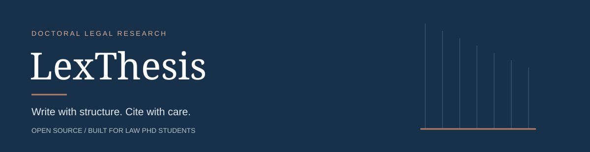
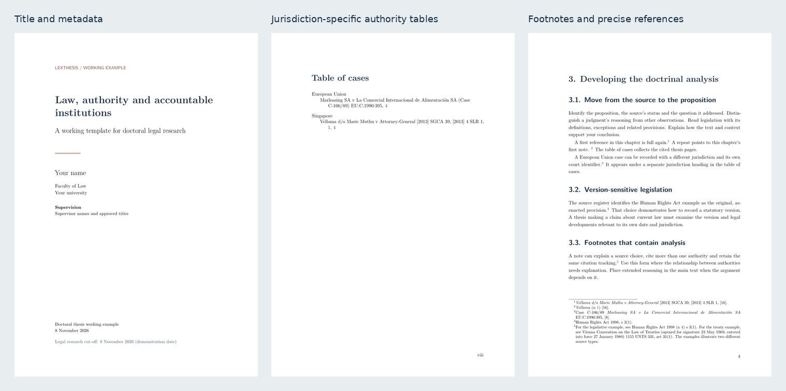

<p align="center"></p>

# LexThesis

**A law PhD template that helps you write, verify and finish.**

[](https://github.com/Albertito-AI/law-phd-thesis-template/actions/workflows/check.yml)
[](LICENSE)

[**Read the example PDF**](examples/lexthesis-example.pdf) · [**Download the Overleaf ZIP**](dist/law-phd-thesis-template.zip) · [**Start here**](docs/getting-started.md) · [**Groningen guide**](docs/groningen.md)

LexThesis is an independently authored LaTeX toolkit for doctoral legal research, created by **Albert Tan Sin Hon**. It brings together legal footnotes, tables of authorities, research-method prompts, source-verification records and practical submission checks. It is free to use and adapt, including outside Groningen.

The project began with a study of [Victor Caldas's Groningen thesis template](https://github.com/vcaldas/Groningen-thesis-template). The implementation is new. Its [provenance record](docs/provenance.md) explains what we learned and why the older code, font binaries, logos and personal thesis material were not copied.

[](examples/lexthesis-example.pdf)

## What you get

| Capability | How it helps |
| --- | --- |
| Legal footnotes | Full first citations, author-controlled short forms, exact pinpoints and linked note references; first citations restart by chapter. |
| Tables of authorities | Separate cases, legislation and treaty tables, grouped by jurisdiction and indexed to thesis pages. |
| Secondary-source bibliography | Cited secondary sources only, sorted by an explicit author-controlled key. |
| Six-chapter research scaffold | Question and contribution; methods; doctrinal analysis; comparative analysis; synthesis; conclusion. |
| Article-based alternative | A separate example explains coherence, contribution attribution, publication status and permissions. |
| Reading, print and review copies | A4 reading copy, double-sided print, double-spaced review with line numbers, and configured anonymous review. |
| Groningen profile | Explicit 170 × 240 mm print layout, approved-title-PDF insertion point, translated-summary appendix and a separate propositions sheet. |
| Research records | Editable claim/evidence, comparative analysis and AI-use CSVs, plus a source register with primary links. |
| Practical checks | Duplicate/unknown source detection, cross-reference checks, build-log review, dependency diagnosis and strict placeholder checks. |
| Portable source bundle | A deterministic source ZIP for Overleaf or local work, with a SHA-256 manifest; designated private folders, Git history and build outputs are excluded. |
| Conservative build defaults | No TeX shell escape, minimal CI permissions, pinned Actions, no embedded credentials and no automatic publication of a student's thesis. |

**Support is deliberately specific.** The citation engine formats citations that you supply and checks mechanical consistency. It is not a complete OSCOLA 5, AGLC or Bluebook renderer, a legal citator, or a university approval service. See [citation support](docs/citations.md), [institutional scope](docs/groningen.md) and [verified behaviour](docs/verification.md).

## Start in Overleaf

1. Download the [source ZIP](dist/law-phd-thesis-template.zip).
2. In Overleaf, choose **New Project → Upload Project** and upload the ZIP.
3. Set the compiler to **LuaLaTeX** and the main document to **main.tex**. Use a recent TeX Live version available in the project settings.
4. Edit [config/metadata.tex](config/metadata.tex), then replace the example chapters.
5. Add your authorities in [references/authorities.tex](references/authorities.tex) and record their provenance in [references/source-register.csv](references/source-register.csv).

The committed `latexmkrc` configuration builds the authority tables without asking TeX to execute shell commands. Python is used for the optional local checks and source export, not for ordinary Overleaf typesetting.

## Start locally

Install Python 3.10+ and a working TeX Live or MiKTeX installation with LuaLaTeX, `latexmk` and MakeIndex. The [installation guide](docs/getting-started.md) gives platform-specific instructions.

```bash
git clone https://github.com/Albertito-AI/law-phd-thesis-template.git
cd law-phd-thesis-template
python3 scripts/doctor.py
python3 scripts/check.py
python3 scripts/build.py main
```

Open `build/main/main.pdf`. Instructional prompts produce review warnings in the supplied template; they are intentional and must be replaced in a real thesis.

| Document | Command | Purpose |
| --- | --- | --- |
| `main.tex` | `python3 scripts/build.py main` | Comfortable A4 reading copy |
| `review.tex` | `python3 scripts/build.py review` | Double-spaced body and line numbers |
| `print.tex` | `python3 scripts/build.py print` | Double-sided A4, chapters on right-hand pages |
| `anonymous.tex` | `python3 scripts/build.py anonymous` | Suppresses configured identity fields, declarations, acknowledgements and CV |
| `groningen.tex` | `python3 scripts/build.py groningen` | Groningen-oriented 170 × 240 mm print layout |
| `articles.tex` | `python3 scripts/build.py articles` | Example with article-integration chapter |
| `propositions.tex` | `python3 scripts/build.py propositions` | Separate editable propositions sheet |

The Dutch summary is a removable multilingual demonstration in the generic example and an institution-specific element in the Groningen profile. Confirm the languages and preliminary sections required by your university.

## A legal footnote in three lines

```tex
A first reference identifies a precise paragraph.\lawcite[{[16]}]{vellama2013}
The same source then receives its short form.\lawcite[{[16]}]{vellama2013}
An analytical note can contain citations.\footnote{See \lawref[s~3(1)]{hra1998}.}
```

Define the source once using separate fields for full citation, short form, table entry, jurisdiction and sorting. Read the [citation guide](docs/citations.md) before adding sources. The examples are genuine authorities with a stated verification scope; their inclusion does not establish their relevance or current legal effect for your thesis.

## Evidence and institutional requirements

The Groningen profile was checked against the **March 2026 PhD Regulations** and **Version 4.0, October 2026 formatting instructions**. These are different documents. The guide identifies their respective requirements, including an apparent difference concerning the CV. It does not reproduce ceremonial wording or imply university endorsement.

Oxford's OSCOLA page identifies the fifth edition while explicitly describing its reference-manager styles as fourth-edition tools pending updates. LexThesis therefore uses transparent, author-curated citation fields and states its limits. See the [dated source review](docs/source-review.md) for primary links and the decisions derived from them.

## Before sharing or submitting

```bash
python3 scripts/check.py --submission
python3 scripts/check.py --log build/main/main.log
python3 -m unittest discover -s tests -v
python3 scripts/package.py
```

The strict submission check intentionally fails the untouched example. A passing check confirms only the mechanical conditions it tests. Read the PDF and use the [submission checklist](docs/submission-checklist.md) for source accuracy, permission, privacy and institutional approval.

Start your actual thesis in a **private** project. Anonymous mode removes specified fields; it cannot recognise identifying prose, self-citations, file attachments or every embedded property. TeX and Lua are executable languages: compile untrusted projects in an isolated environment. See [SECURITY.md](SECURITY.md).

## Documentation

- [Getting started and troubleshooting](docs/getting-started.md)
- [Customising the thesis](docs/customisation.md)
- [Citation mechanics and supported scope](docs/citations.md)
- [Designing a defensible research project](docs/research-design.md)
- [Groningen regulations and finalisation](docs/groningen.md)
- [Submission and evidence checks](docs/submission-checklist.md)
- [Accessibility and PDF limitations](docs/accessibility.md)
- [Source review and design decisions](docs/source-review.md)
- [Verification record](docs/verification.md)
- [Changes](CHANGELOG.md) and [contributing](CONTRIBUTING.md)

## Licence and contributions

The original template code and guidance are available under the [MIT licence](LICENSE). **Your thesis remains your work.** The template licence does not determine the rights in your thesis, articles, images, data or third-party material. No citation to this toolkit is required; [CITATION.cff](CITATION.cff) is supplied for those who wish to acknowledge it.

Contributions from law researchers, librarians, accessibility specialists and LaTeX users are welcome. Useful contributions include a verified institutional profile, a minimal citation regression case, an accessibility improvement or a clearer newcomer instruction. Please provide primary sources, exact versions and a testable example.
